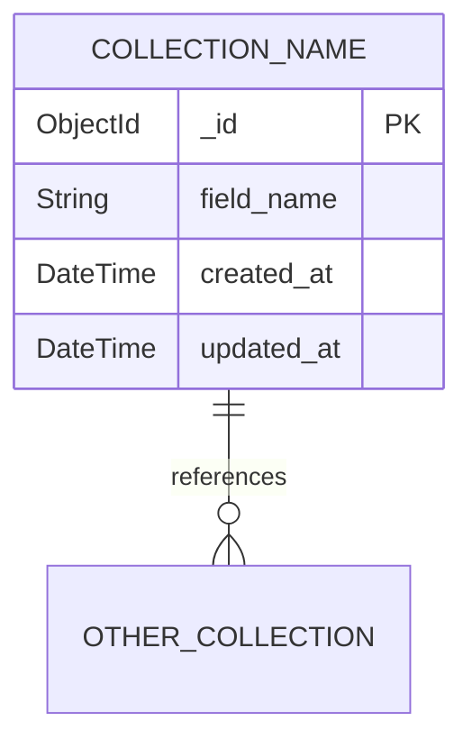

# Database Specifications

MongoDB schema conventions, examples, and query patterns.

> **NOTE:** Skip if `../apps/backend/` does not exist.
---

## Naming Conventions
- **Database**: Table names and column names MUST use `snake_case` format (e.g., `user_profiles`, `created_at`).
- **Rust**: Struct and Enum names MUST use `PascalCase` (e.g., `UserProfile`), while variable/field names use `snake_case`.

## Schema Definition Format

Before creating a new collection, define it in `docs/database_schema.md` (Schema Registry):

```
Collection: collection_name
Fields:
  - _id: ObjectId (auto)
  - field_name: String (required)
  - other_field: Number (optional)
  - created_at: DateTime (auto)
  - updated_at: DateTime (auto)
Indexes:
  - { field_name: 1 } (unique)
  - { created_at: -1 }
Relations:
  - user_id → users._id
```

## Example Schema — Users

```
Collection: users
Fields:
  - _id: ObjectId (PK)
  - username: String
  - email: String (unique, sparse)
  - password_hash: String (required)
  - fullname: String
  - phone: String (required)
  - gender: String
  - about: String
  - image: String (URL)
  - status: String (Enum: "active" | "inactive" | "suspended")
  - date_of_birth: Int (Unix timestamp)
  - last_active: Int (Unix timestamp)
  - expired_date: Int (Unix timestamp)
  - multi_login: Boolean (default: false)
  - email_verified: Boolean (default: false)
  - address: Object { street, city, province, country, postal_code }
  - tags: Array<String>
  - additional: Object (free-form metadata)
  - created_by: String (ref → users._id)
  - permission_id: ObjectId (ref → permissions._id)
  - group_id: ObjectId (ref → groups._id)
  - created_at: DateTime (default: now)
  - updated_at: DateTime (default: now)
```


## Example Schema — Auth

```
Collection: auth
Fields:
  - _id: ObjectId (PK)
  - email: String (unique, sparse)
  - password: String (required)
```

## Example Schema — Permissions

```
Collection: permissions
Fields:
  - _id: ObjectId (PK)
  - name: String (required)
  - description: String
  - alias: String (unique, slug-friendly)
  - type: String (Enum: "role" | "policy" | "custom")
  - image: String (URL)
  - privileges: Object | Array (access definitions per module)
  - created_by: String (ref → users._id)
  - parent_id: ObjectId (ref → permissions._id, for hierarchy)
  - created_at: DateTime (default: now)
  - updated_at: DateTime (default: now)
```

## Example Schema — Group

```
Collection: groups
Fields:
  - _id: ObjectId (PK)
  - name: String (required)
  - description: String
  - image: String (URL)
  - parent_id: ObjectId (ref → groups._id, for subgroup)
  - connection_group_id: ObjectId (reference to external group)
  - settings: Object (display/behavior configuration)
  - personalization: Object (visual preferences per group)
  - filters: Array<Object> (default data filters for group members)
  - created_at: DateTime (default: now)
  - updated_at: DateTime (default: now)
```

## Schema Visualization (ERD)

Use Mermaid.js blocks to visualize the ERD whenever a new schema is added or relations change:



---

## Schema Registry

> Register all active collections here. Update whenever a schema is added or changed.

*(no collections yet — add when the first feature is implemented)*

---

# PostgreSQL (book library)

New domain data lives in PostgreSQL (MongoDB is only for the legacy auth/user modules).
Migrations: `apps/backend/migrations/NNN_name.sql`, applied in order at startup or with `uv run python -m util.migrate`; recorded in `schema_migrations`. Never edit an applied migration — add a new file.

```
Table: books                                  (migrations/001_create_books.sql)
Columns:
  - id: uuid PK (gen_random_uuid())
  - title: text NOT NULL (not blank)
  - authors: text[] · subjects: text[]
  - description, isbn, cover_url, publisher, language: text
  - published_year: integer (0–3000)
  - metadata_source: text — manual | openlibrary | upload
  - external_id: text (e.g. Open Library work key)
  - file_name, file_path, file_sha256: text · file_size_bytes: bigint · page_count: integer
  - ingestion_status: text — none | queued | processing | indexed | failed   (none = metadata only)
  - ingestion_error: text · chunk_count: integer · embedding_model: text · indexed_at: timestamptz
  - ingestion_attempts: integer NOT NULL DEFAULT 0 (≥ 0) — worker claims since upload/reindex;
    startup recovery re-queues interrupted jobs below BE_INGESTION_MAX_ATTEMPTS   (migrations/003_ingestion_attempts.sql)
  - created_at, updated_at: timestamptz
Indexes:
  - unique (isbn) WHERE isbn IS NOT NULL
  - unique (file_sha256) WHERE file_sha256 IS NOT NULL
  - unique (metadata_source, external_id) WHERE external_id IS NOT NULL
  - (ingestion_status), (created_at DESC)
```

```
Table: conversations                          (migrations/002_create_conversations.sql)
Columns:
  - id: uuid PK (gen_random_uuid())
  - title: text NOT NULL (not blank) — first question, renameable
  - book_ids: uuid[] — book scope of the latest question ('{}' = all indexed books; no FK, books may be deleted)
  - created_at, updated_at: timestamptz (updated_at bumps on every message → sidebar order)
Indexes:
  - (updated_at DESC)

Table: conversation_messages
Columns:
  - id: uuid PK · seq: bigint identity (insertion order; always ORDER BY seq)
  - conversation_id: uuid FK → conversations ON DELETE CASCADE
  - role: text — user | assistant
  - content: text — question, answer, or partial answer (stopped/error)
  - mode: text (assistant) — llm | insufficient_context | no_context | no_indexed_books | retrieval_only | error | stopped
  - grounded: boolean · model: text · error: text
  - sources: jsonb — snapshot of the cited/uncited passages (/chat/ask source shape)
  - skipped_books: jsonb
  - book_ids: uuid[] (user) — scope the question was asked with
  - created_at: timestamptz
Indexes:
  - (conversation_id, seq)
```

# Redis (chat sessions)

```
chat:session:{session_id}:events      STREAM  {event, data(json)} per SSE event; entry id = SSE event id; MAXLEN ~10000
chat:session:{session_id}             HASH    status running|done|error|cancelled, conversation_id, heartbeat, created_at, finished_at
chat:session:{session_id}:cancel      STRING  "1" when Stop was requested
chat:conversation:{conversation_id}:active  STRING  session id while that conversation's answer is being generated
TTL: BE_CHAT_SESSION_TTL_SECONDS (3600), refreshed while the session runs. Redis also holds rate-limit counters.
```

# Qdrant (book chunks)

```
Collection: book_chunks (BE_QDRANT_COLLECTION) — vectors 1024-dim, cosine
Point id: uuid5(book_id, chunk_index)  — deterministic, re-indexing overwrites
Payload: book_id (keyword index), chunk_index (integer index), book_title, text, headings[], page_start, page_end, embedding_model
```
